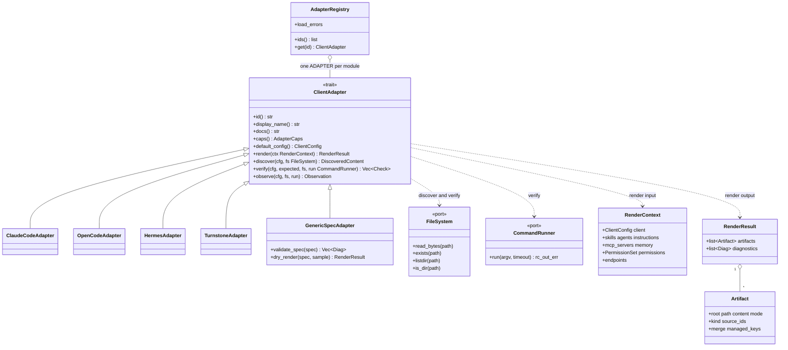

# Client adapter classes

Mermaid. Names are from `backend/crates/agent-hub/src/adapters/` (Rust since 0.3.0): `ClientAdapter` is a trait with a
default `observe`, each adapter file exposes `adapter()`, and the build registers every file.

Rules that hold for every adapter: `render` is pure; artifacts use relative safe paths under a named root; output is
deterministic; an agent with no tools is an error; unsupported or lossy mappings are diagnostics (`error` when the client
is `strict`); `verify` must not report `ok` from a copy alone.
